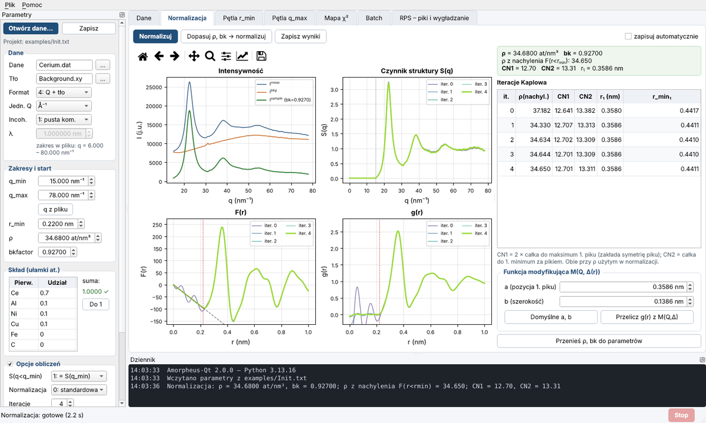

# Amorpheus-Qt 2.0

🇬🇧 [English version](README.md)

Program z interfejsem graficznym do analizy danych **rozpraszania promieniowania X przez materiały amorficzne
i ciecze**: od zintegrowanego dyfraktogramu 1D do czynnika struktury S(q), zredukowanej funkcji rozkładu
F(r), funkcji rozkładu par g(r), gęstości atomowej ρ i liczb koordynacyjnych.

To przepisana od nowa wersja programu **Amorpheus** (S. Boccato i in., 2022), stworzonego
do pomiarów cieczy i szkieł m.in. w komórkach diamentowych (DAC). Fizyka obliczeń jest taka sama jak w oryginale.
Doszły: interfejs PyQt5, automatyczne odczytywanie parametrów z plików danych, szybsze obliczenia i kilka
poprawek błędów.

Oryginał: <https://github.com/CelluleProjet/Amorpheus>



---

## Spis treści

- [Możliwości](#możliwości)
- [Instalacja](#instalacja)
- [Szybki start](#szybki-start)
- [Dane wejściowe](#dane-wejściowe)
- [Okno programu](#okno-programu)
- [Wskazówki praktyczne](#wskazówki-praktyczne)
- [Pliki wynikowe](#pliki-wynikowe)
- [Zmiany względem oryginału](#zmiany-względem-oryginału-v105)
- [Test zgodności](#test-zgodności)
- [Użycie w skryptach](#użycie-w-skryptach)
- [Cytowanie i licencja](#cytowanie-i-licencja)

---

## Możliwości

- **Normalizacja** metodą Krogh-Moe/Normana (Morard i in. 2013, równ. 10) z iteracyjną korektą Kaplowa/Eggerta.
- **Dopasowanie gęstości ρ i skali tła** (bkfactor) przez minimalizację χ² = ∫₀^rmin [F(r) + 4πρr]² dr.
- **Pętle r_min i q_max**: sprawdzenie, jak wynik zależy od parametrów; ρ wybiera się z plateau.
- **Mapa χ²(ρ, bk)** z konturami.
- **Tryb wsadowy (batch)** dla serii pomiarów (tabela .ods, .xlsx lub .csv).
- **RPS**: usuwanie pików krystalicznych (Lorentz, Gauss, Voigt), zastępowanie zakresu prostą, wygładzanie.
- **Funkcja modyfikująca M(Q, Δ(r))** do ograniczenia oscylacji od urwania transformaty.
- **Liczby koordynacyjne** CN1 i CN2 oraz gęstość z nachylenia F(r) dla każdej iteracji.
- **Otwieranie danych z autodetekcją**: jednostka osi, długość fali, zakres, skład z nazwy pliku, plik tła.
- Pliki projektu `Init.txt` są **zgodne z oryginałem w obie strony**.

## Instalacja

Wymagany jest Python ≥ 3.9 z pakietami: numpy, scipy, matplotlib, PyQt5, lmfit, xraylib, pandas, odfpy, openpyxl.
Program działa na Windows, Linuksie i macOS.

### Windows + Miniconda (zalecane)

1. Zainstaluj [Minicondę](https://docs.conda.io/en/latest/miniconda.html), jeśli jej jeszcze nie masz.
2. Uruchom **`instaluj.bat`**. Utworzy środowisko conda `amorpheus` (pakiety z conda-forge) i uruchomi test
   zgodności. Trwa to kilka minut.
3. Program uruchamiasz plikiem **`uruchom.bat`**. Możesz też przeciągnąć na niego plik danych albo `Init.txt`.

### Ręcznie (conda)

```bash
conda create -n amorpheus -c conda-forge python=3.11 numpy scipy matplotlib pyqt lmfit xraylib pandas odfpy openpyxl
conda activate amorpheus
python amorpheus_qt.py
```

### pip

```bash
pip install -r requirements.txt
python amorpheus_qt.py
```

Pakiet `xraylib` nie dla każdej wersji Pythona ma w pip gotową wersję dla Windows. Jeśli instalacja się nie
powiedzie, użyj condy.

## Szybki start

**Przykład:** przy pierwszym uruchomieniu wczytuje się przykład z oryginału (szkło na bazie Ce, `examples/`).
Kliknij **Normalizacja → Normalizuj**. Przykład można wczytać ponownie: **Plik → Wczytaj przykład**.

**Własne dane:**

1. **Plik → Otwórz dane…** (Ctrl+O), przycisk „Otwórz dane…” w panelu albo przeciągnięcie pliku na okno.
2. W oknie dialogowym program pokazuje, co odczytał z pliku. Wszystko można poprawić:
   - jednostkę osi (Q w Å⁻¹ lub nm⁻¹, 2θ) i długość fali z nagłówka pyFAI, Dioptasa albo Fit2D;
   - zakres danych bez skrajnych obszarów z I = 0 (brak pokrycia detektora) i propozycję q_min/q_max;
   - skład z nazwy pliku, np. `Mg61Cu28Gd11_…` → Mg 0,61 / Cu 0,28 / Gd 0,11 (gdy w nazwie jest „wt”,
     udziały wagowe są przeliczane na atomowe);
   - gęstość liczbową ρ = 602,2·d / M̄, jeśli podasz gęstość masową d [g/cm³];
   - plik tła z tego samego folderu (nazwy zawierające *bkg*, *background*, *empty*, *gasket*…).
3. **Utwórz projekt** zapisuje obok danych plik `<nazwa_danych>_Init.txt`. Projekt zapisuje się też sam przy
   każdym uruchomieniu obliczeń i przy zamknięciu programu. Wyniki trafiają do folderu z danymi.
4. Przy ponownym otwarciu tych samych danych program proponuje wczytanie zapisanego projektu.

Typowy przebieg analizy: **Pętla r_min** (wybór r_min z plateau ρ) → **Pętla q_max** → **Normalizacja**
→ **Zapisz wyniki**.

Pliki `Init.txt` z oryginalnego Amorpheusa otwiera się przez **Plik → Otwórz projekt** (Ctrl+Shift+O).

## Dane wejściowe

- **Format:** dwie kolumny tekstowe (x, I). Separator może być spacją, tabulatorem, średnikiem lub przecinkiem;
  dozwolony jest przecinek dziesiętny i nagłówki (`#`). Kodowanie nagłówków nie ma znaczenia (UTF-8, Latin-1).
- **Oś x:** 2θ [°] (wymaga λ) albo Q w Å⁻¹ lub nm⁻¹.
- **Tło:** pomiar pustej komórki lub uchwytu (zalecane) albo tło zmierzone na próbce.

> **Ważne:** ani ten program, ani oryginalny Amorpheus **nie** wykonują korekt na polaryzację, absorpcję
> i rozpraszanie wielokrotne. Należy je wykonać wcześniej, przy integracji danych (np. w pyFAI/Dioptasie: polaryzacja ≈ 0,99 dla
> synchrotronu). Brak korekty polaryzacji przy dużych kątach 2θ zaniża natężenie przy wysokim Q, a wtedy
> dopasowanie ρ i bkfactor staje się niestabilne.

## Okno programu

Interfejs jest po polsku.

### Panel parametrów (po lewej)

| Pole | Znaczenie |
|---|---|
| Dane / Tło | pliki danych i tła |
| Format | 1: 2θ bez tła · 2: 2θ + tło · 3: Q bez tła · 4: Q + tło |
| Jedn. Q | Å⁻¹ (jak w oryginale) albo nm⁻¹ (np. pyFAI `q_nm^-1`); tylko formaty 3 i 4 |
| Incoh. | 1: tło z pustej komórki, odejmowane jest rozpraszanie Comptona próbki; 0: tło zmierzone na próbce |
| λ [nm] | długość fali; tylko dla danych w 2θ |
| q_min, q_max [nm⁻¹] | zakres analizy (1 Å⁻¹ = 10 nm⁻¹) |
| r_min [nm] | promień odcięcia: dla r < r_min wymagane jest F(r) = −4πρr |
| ρ [at/nm³], bkfactor | wartości do normalizacji i punkt startowy dopasowania (granice: ρ₀ ± 50, bk 0,7–1,2) |
| Skład | udziały atomowe; „Do 1” uzupełnia zaznaczony wiersz tak, aby suma = 1 |
| S(q<q_min) | 1: stała = S(q_min) (zalecane); 0: zero; 2: lorentzowka (niestabilne, tylko diagnostyka) |
| Normalizacja | 0: standardowa; 1: dodatkowo g(r) z funkcją modyfikującą M(Q, Δ(r)) |
| Iteracje | liczba iteracji Kaplowa (4 jak w oryginale) |
| r_max wyn. | zasięg F(r) i g(r) w plikach wynikowych |
| Poprawka jedn. | poprawka reguły sum (zalecana); odznaczenie daje wyniki identyczne z v1.0.5 |

Grupy „Opcje obliczeń” i „Zapis wyników” zwija się kliknięciem w tytuł. Pełny opis parametrów jest w menu
**Pomoc → Pomoc – opis parametrów**.

### Zakładki

- **Dane**: surowe dane i tło. Żółty pas pokazuje analizowany zakres, a górna oś to q w nm⁻¹.
- **Normalizacja**: I(q), S(q), F(r) i g(r) dla każdej iteracji. Tabela pokazuje gęstość z nachylenia
  F(r < r_min), CN1, CN2 i położenia pików. Przycisk „Dopasuj ρ, bk → normalizuj” najpierw minimalizuje χ²,
  a potem normalizuje. Funkcja modyfikująca ma regulowane parametry a i b.
- **Pętla r_min** / **Pętla q_max**: dopasowanie ρ (i bk) dla serii wartości. Tabela wypełnia się na bieżąco;
  wybrany wiersz można przyjąć do parametrów.
- **Mapa χ²**: χ²(ρ, bk) na siatce, w wersji surowej i znormalizowanej. Minimum można przyjąć do parametrów.
- **Batch**: seria pomiarów z tabeli w układzie `Batch.ods` z oryginału (przykład: `examples/Batch.csv`).
  Wiersze zaczynające się od `#` są pomijane.
- **RPS**: usuwanie pików krystalicznych i wygładzanie. Zakres zaznacza się na wykresie: lewy klik to początek,
  prawy koniec. Wynik można od razu ustawić jako plik danych.

Obliczenia działają w tle, więc okno nie zamarza. **Stop** przerywa pętlę, a wyniki częściowe zostają zachowane.

## Wskazówki praktyczne

- **r_min wybieraj z plateau ρ(r_min)**, a nie z globalnego minimum χ². χ² rośnie z r_min, bo całka obejmuje
  dłuższy przedział, więc porównuj je tylko lokalnie. r_min musi być mniejsze niż najkrótsza odległość
  międzyatomowa.
- **q_max:** pętla q_max pokazuje, od którego miejsca szum i błędy przy wysokim Q zaczynają zmieniać ρ.
  Rozrzut ρ w rozsądnym zakresie q_max to dobra miara niepewności.
- **bkfactor na granicy (0,7 lub 1,2)** oznacza, że coś jest nie tak z tłem albo z korektami danych
  (najczęściej z polaryzacją). Wtedy wyniku nie należy traktować jako ostatecznego.
- **CN1** liczona jest jako 2 × całka do maksimum pierwszego piku (zakłada symetrię piku), więc w stopach
  wieloskładnikowych bywa zaniżona. CN2 (całka do pierwszego minimum) jest zwykle bardziej wiarygodna.
- **RPS:** dopasowuj piki tylko w wąskim zakresie wokół piku. Dopasowanie w całym zakresie danych zniszczy
  sygnał amorficzny; program ostrzega, gdy zakres przekracza 25% danych.

## Pliki wynikowe

Nazwy i kolumny są takie jak w oryginale. Każdy plik ma dodatkowo nagłówek z parametrami.

| Operacja | Pliki |
|---|---|
| Normalizacja | `Norm_I.txt` (q, Imeas, Ibkg, Isample), `Norm_S.txt` (q, S iteracji 0…n), `Norm_S_lastcolumn.txt`, `Norm_F.txt`, `Norm_gder.txt` (r, g iteracji), `Norm_CN.txt` (ρ z nachylenia, CN1, CN2, położenia pików), `*.png`, `Norm_overview.png`; przy funkcji modyfikującej także `Norm_grlast.txt` i `Norm_deltaR.txt` |
| Pętla r_min | `MinRmin_<dane>-<tło>_<od>-<do>.txt` (rmin, ρ, bk, χ²) + `.png` |
| Pętla q_max | `MinQmax_<dane>-<tło>_<od>-<do>.txt` (qmax, ρ, bk, χ²) + `.png` |
| Mapa χ² | `Norm_Chi2.txt` (wiersze = ρ), `Norm_Chi2_norm.txt`, `Norm_Chi2_axes.txt`, `.png` |
| Batch | folder `Batch_RRRRMMDD_HHhMM` z plikami `S_`, `F_`, `gder_`, `grlast_` (.txt, .png) dla każdego wiersza, `Batch_results_*.txt`, `Batch_results.png` i kopią tabeli |

Istniejące pliki nie są nadpisywane: do nazwy dopisywany jest numer `_0`, `_1`… (chyba że zaznaczysz
„Nadpisuj pliki”). Pliki zapisywane są w UTF-8.

## Zmiany względem oryginału v1.0.5

- **Zgodność:** przy odznaczonej poprawce jednostek wyniki (S, F, g, CN, ρ z nachylenia, χ², dopasowania,
  pętle) są identyczne z oryginałem z dokładnością ≤ 1e-13. Sprawdza to `tests/test_against_original.py`.
- **Poprawka jednostek w normalizacji** (domyślnie włączona): w oryginale całki reguły sum Krogh-Moe liczono
  po dq w nm⁻¹ przy Q² w Å⁻², przez co człon −2π²ρ był 10× za mały. Po poprawce ∫q²(S−1)dq = −2π²ρ zgadza
  się dokładnie. Dla przykładu Ce ρ się nie zmienia, a bkfactor zmienia się z 0,9281 na 0,9259.
- **Wczytywanie danych:** oryginał po cichu pomijał wiersze zaczynające się od „-” lub „.”, czyli np. ujemne
  intensywności po odjęciu tła. Teraz są wczytywane. Obsługiwane są różne separatory, przecinek dziesiętny
  i nagłówki w dowolnym kodowaniu.
- **Szybkość:** dopasowanie jest ok. 4× szybsze, bo macierz sin(qr) liczona jest raz i tylko dla r < r_min.
- **Działa z NumPy 2.x i SciPy ≥ 1.14** (oryginał używał usuniętych `np.trapz` i `scipy.integrate.trapz`).
  Batch nie wymaga przestarzałego pakietu `ezodf`.
- **Bezpieczeństwo:** zawartość `Init.txt` nie jest wykonywana przez `exec`/`eval`.
- **Nowe funkcje:** interfejs graficzny, otwieranie danych z autodetekcją i automatycznym projektem, Q w nm⁻¹,
  pomijanie obszarów z I = 0 na krańcach danych, `%` w nazwach plików, plik `Norm_CN.txt`, mapa χ² w GUI.
- **Drobne poprawki:**
  - brak NaN w funkcji modyfikującej w punkcie r = a;
  - poprawny nagłówek pliku pętli q_max;
  - wykres ρ(q_max) zapisywał się pod prefiksem pętli r_min;
  - Erase w RPS gubił ostatni punkt;
  - błąd w jednym wierszu batcha nie przerywa całości;
  - nazwy plików nie zależą od długości rozszerzenia;
  - nazwy plików bez rozróżniania wielkości liter na każdym systemie (jak na Windows).

Fizyka nie została zmieniona: normalizacja z równania 10 (Morard 2013), 4 iteracje Kaplowa,
χ² = ∫₀^rmin [F(r) + 4πρr]² dr, Nelder-Mead (lmfit, 500 wywołań, tol 1e-4), czynniki rozpraszania z xraylib.

## Test zgodności

```bash
python tests/test_against_original.py
```

Test liczy wyniki referencyjne **oryginalnym** `equations.py` (normalizacja dla formatów 1–4, SofQ 0/1, QStep,
χ², dopasowania, pętle r_min i q_max). Następnie liczy to samo nowym kodem w trybie zgodności i porównuje
43 wielkości na pełnych tablicach. Trwa to ok. 2–3 min. Kopia oryginału jest w `tests/_original_equations.py`.

## Użycie w skryptach

Obliczenia są oddzielone od interfejsu, więc można ich używać bez GUI:

```python
from amorpheus.data import load_init
from amorpheus import analysis as an, export as ex

p = load_init("examples/Init.txt")
fit = an.fit_density(p)                              # rho, bkfactor, chi2
res = an.run_normalization(p, rho=fit.rho, bk=fit.bkfactor)
ex.save_normalization(res, "wyniki")
```

### Struktura

```
amorpheus_qt.py          uruchomienie GUI
amorpheus/physics.py     czynniki rozpraszania (xraylib), normalizacja, Kaplow, χ², CN, funkcja modyfikująca
amorpheus/data.py        parametry, Init.txt, wczytywanie plików, tabela batch
amorpheus/autodetect.py  odczyt parametrów z pliku danych (nagłówek, zakres, skład z nazwy, gęstość)
amorpheus/analysis.py    normalizacja, dopasowanie, pętle, mapa χ², batch
amorpheus/export.py      zapis wyników
amorpheus/plots.py       wykresy
amorpheus/rps.py         usuwanie pików i wygładzanie
amorpheus/gui/           interfejs PyQt5
examples/                dane przykładowe (szkło Ce) i przykładowa tabela batch
tests/                   test zgodności z oryginałem
```

## Cytowanie i licencja

Korzystając z programu w publikacji, cytuj oryginalną pracę:

> S. Boccato, Y. Garino, G. Morard, B. Zhao, F. Xu, C. Sanloup, A. King, N. Guignot, A. Clark, G. Garbarino,
> *Amorpheus: a Python-based software for the treatment of X-ray scattering data of amorphous and liquid
> systems*, High Pressure Research **42**(1), 69–93 (2022),
> doi:[10.1080/08957959.2022.2032032](https://doi.org/10.1080/08957959.2022.2032032)

Metoda normalizacji pochodzi z pracy G. Morarda i in. (2013); pełna referencja jest w powyższym artykule.

Licencja: **GNU GPL v3**, taka jak oryginału (plik [LICENSE](LICENSE)).
